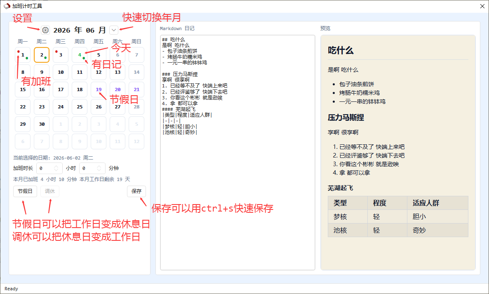
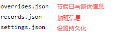

# 加班计时工具

WPF 桌面加班记录与日记应用。

## 功能

### 主页面

### 设置缓存

### 工作日规则

**按周算**: 每n周为一个周期循环 以当前周为第1周
- 假如你是大小周 本周是小周 那么你可以设置成 第一周五天 第二周六天
- 假如你是大小周 本周是大周 那么你可以设置成 第一周六天 第二周五天
- 假如你是逆天的大中小周(61 52 43这样) 本周是中周 那么你可以设置成 第一周五天 第二周四天 第三周六天

**按天算**: 上x休y 今天是轮转的第z天

### 颜色与外观

提供 9 套一键切换的主题配色（含 3 套深色主题），选择后自动应用到整个界面：

- 浅色：海盐蓝、焦糖暖棕、薄荷奶绿、樱花粉、薄雾紫、月岩灰
- 深色：午夜蓝、摩卡夜、紫夜
- 主题会统一调整窗口、卡片、月历文字、提示点、按钮强调色和 Markdown 预览配色
- 旧版自定义颜色会自动匹配升级，无需重新配置

### 本地化

- 虽然做了 但是暂时没有实装新增语言包的方式
- 有需求的话发issue 找时间实装一下
